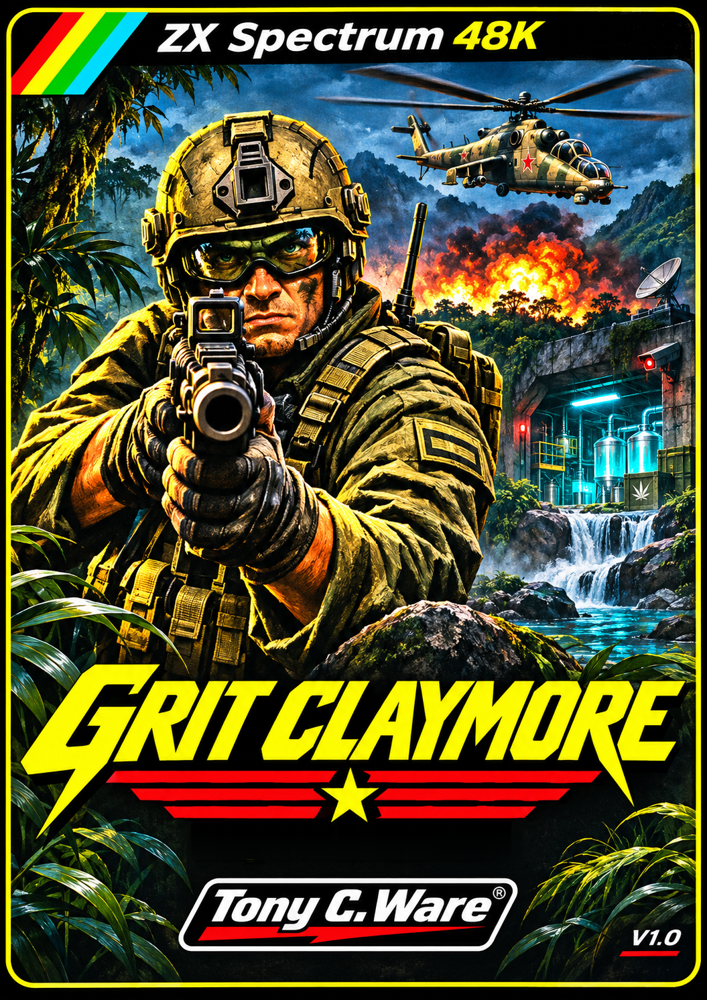

# GRIT CLAYMORE

**Edición v1.14 · ZX Spectrum 48K · © 2026 Tony C. Ware**



## 2026. El mundo no se salvará por sí mismo.

Grit Claymore, agente de la organización ficticia **EFEC (European Federation Enforcer Corps)** vinculada al EU INTCEN, combate en una región aislada de Vietnam al ejército renegado de **El Comisario**, responsable del tráfico de drogas y armamento experimental.

[**Descargar la única release vigente: v1.14**](https://github.com/OnRail76/Grit-Claymore/releases/tag/v1.14) · [TAP directo para Spectrum 48K](juego/GRIT_CLAYMORE_V1.14_48K.tap)

## Novedades de la v1.14 — Suministros y combate

- **Soldados:** Jungla y Laboratorio mantienen refuerzos y emboscadas al avanzar; los nuevos emplazamientos exigen una salida transitable, evitando enemigos atrapados en el paisaje.
- **Mechas:** fijan la puntería durante el destello de carga, disparan ráfagas de tres proyectiles por turnos y alternan formaciones en V y escalonadas.
- **Raciones:** aparecen en espacios realmente transitables de 2×2, pueden recogerse durante el desplazamiento de pantalla o dentro del tanque, y se añaden dos refuerzos en Laboratorio y tres en Complejo.
- **Cañón de plasma:** hay una caja de munición en cada uno de los tres sectores del Complejo previos al Hind. Cada caja aporta 12 disparos.
- Se mantiene el diseño aprobado de los tres jefes: lancha, camión e Hind Mi-24; la carátula expresionista continúa siendo la oficial.

El título incluye tres fases, barra de salud, tanque en las dos primeras, mechas en el Complejo y enfrentamientos con jefes. Las notas completas están en [RELEASE_NOTES_V1.14.md](RELEASE_NOTES_V1.14.md).

## Controles

| Entrada | Acción |
|---|---|
| **Q / A / O / P** | Moverse (combinando direcciones para diagonales) |
| **ESPACIO** | Disparar y comenzar partida |
| **H** | Pausar / reanudar |
| **Sinclair 6 / 7 / 8 / 9 / 0** | Izquierda / derecha / abajo / arriba / disparo |
| **Kempston** | Empezar la partida pulsando FIRE en el joystick |

## Documentación y arte de la edición vigente

- [Manual oficial v1.14, PDF de 11 páginas](documentacion/GRIT_CLAYMORE_MANUAL_V1_14_OFICIAL.pdf), con la carátula expresionista en portada y anexo de suministros.
- [Atlas visual v1.14, PDF de 6 páginas](documentacion/GRIT_CLAYMORE_ATLAS_VISUAL_V1_14.pdf), con recursos gráficos reales del proyecto y anexo sobre los cambios.
- [Carátula expresionista oficial](caratula/GRIT_CLAYMORE_CARATULA_OFICIAL.png), sin modificaciones.
- [Tres carátulas alternativas](caratula/alternativas/README.md), incluida la portada militar original.
- [Historial técnico consolidado](documentacion/CHANGELOG.md) y [programas utilizados](documentacion/ANEXO_PROGRAMAS_UTILIZADOS.md).

La edición vigente **no incluye manuales/atlas anteriores ni múltiples release notes**. El archivo artístico anterior, si se conserva en la release, queda separado de los PDF vigentes.

## Código fuente y verificación

```bash
python3 -m pip install -r requirements.txt
python3 build_all.py
```

La compilación debe reconstruir exactamente el TAP de `juego/GRIT_CLAYMORE_V1.14_48K.tap`, validado mediante SHA-256 y las pruebas del proyecto.

**SHA-256 v1.14:** `3088339d7a9f822c072f0377abc9872db931b7daa4a6de8498b252c61b7727f3`

**Importante:** las pruebas utilizan un intérprete Z80 parcial. No sustituyen la validación manual en Fuse ni certifican ejecución sobre un Spectrum físico.

## Licencias y créditos

**Idea, dirección creativa y decisiones finales: Tony C. Ware.** Código y herramientas bajo [licencia MIT](LICENSE) ([castellano](LICENSE_ES.md)). Carátulas, gráficos y sprites con derechos reservados; consultar [LICENCIA_GRAFICOS.md](LICENCIA_GRAFICOS.md) y [DERECHOS.md](DERECHOS.md).
