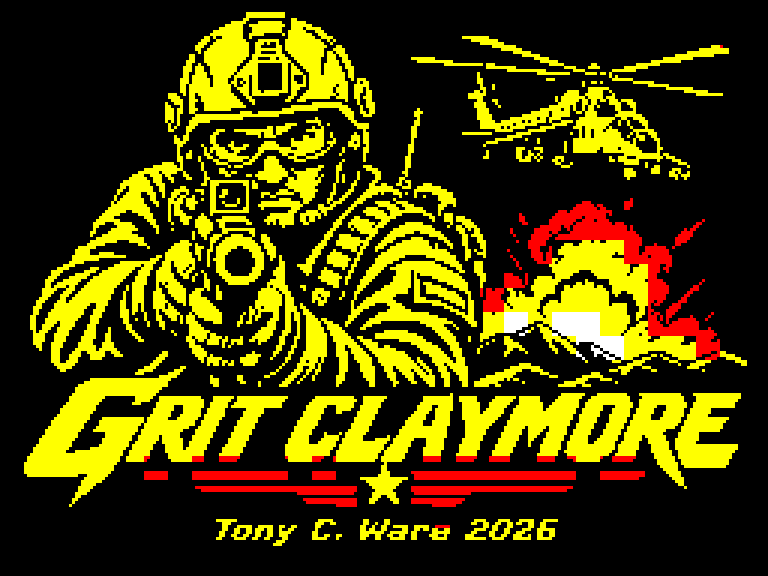
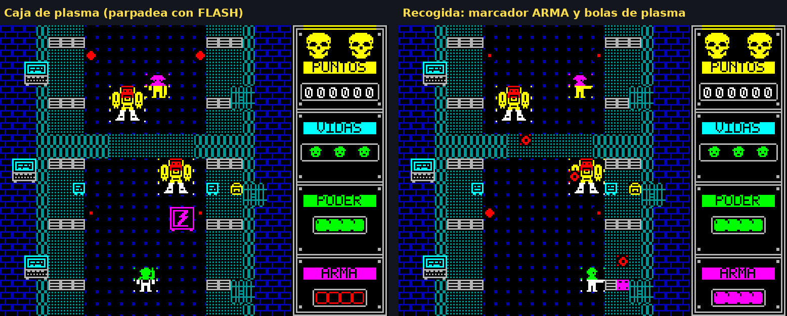
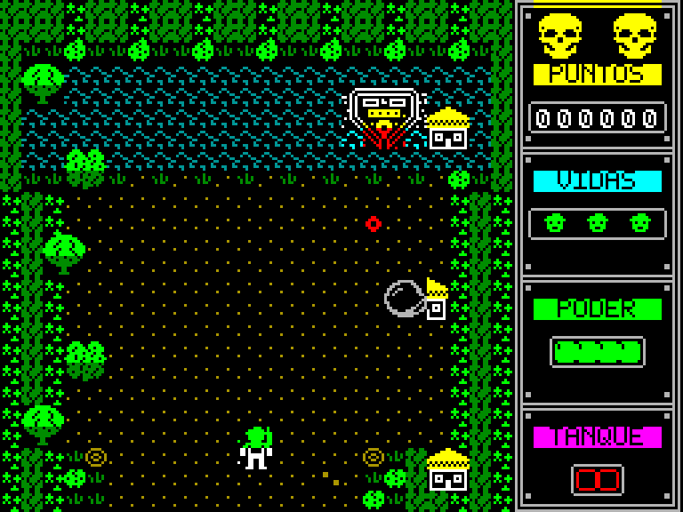

# GRIT CLAYMORE

**Un pequeño arcade de disparos para 48K de Spectrum.**

**ZX Spectrum 48K · Código máquina Z80 · Tony C. Ware · 2026 · V1.6**


## El juego

En el presente, Grit Claymore, operativo del **EFEC (European Federation Enforcer Corps)** —organización ficticia vinculada al EU INTCEN dentro de la historia—, se infiltra en una región remota de Vietnam para destruir una red de narcotráfico, desmantelar el armamento experimental del ejército renegado y detener a **El Comisario**.

Tres fases de arcade vertical, scroll por bloques, sprites enmascarados, gráficos propios y animaciones ambientales de dos fotogramas. Un homenaje a la claridad visual de **Who Dares Wins II** y los primeros **Ultima**.

**El mundo no se salvará por sí mismo.**

## Descargar y jugar

**[Descargar GRIT CLAYMORE V1.6 — Release oficial](https://github.com/OnRail76/Grit-Claymore/releases/tag/v1.6)** · [TAP V1.6 en el repositorio](juego/GRIT_CLAYMORE_V1.6_48K.tap)

La **Release V1.6 ya está publicada**, con el TAP, el [ZIP completo con fuentes](https://github.com/OnRail76/Grit-Claymore/releases/download/v1.6/GRIT_CLAYMORE_V1.6_COMPLETO_CON_FUENTES.zip), la portada oficial, el manual, el atlas y capturas. El código y los archivos del juego siguen accesibles en `main`. Las Releases históricas [V1.0.1](https://github.com/OnRail76/Grit-Claymore/releases/tag/v1.0.1) y [V1.0](https://github.com/OnRail76/Grit-Claymore/releases/tag/v1.0) se conservan sin cambios.

Carga el archivo en **Fuse** seleccionando la máquina **Spectrum 48K**. El juego utiliza el sonido beeper y teclado.

| Tecla | Acción |
|---|---|
| Q | Arriba |
| A | Abajo |
| O | Izquierda |
| P | Derecha |
| ESPACIO | Disparo / empezar |
| H | Pausa (borde azul); otra pulsación reanuda |
| 6 / 7 / 8 / 9 / 0 | Joystick Sinclair (Interface 2): izquierda / derecha / abajo / arriba / fuego |
| Joystick Kempston | Empieza la partida con su FUEGO para jugar con joystick; con SPACE se juega con teclado |

Grit se mueve y dispara en ocho direcciones, con hasta dos balas en pantalla; el tanque se mueve y dispara en cuatro y aguanta cuatro impactos. Hay una ración en cada sector y recupera energía. Los proyectiles del tanque atraviesan obstáculos y el vehículo arrolla a soldados. Cada fase termina con su propio jefe: la lancha patrullera, el camión blindado y el Hind del Comisario. La fase 3 se juega a pie, contra mechas.

### Pantalla de título actualizada (V1.0.1)



La pantalla de título muestra **Q/A/O/P MOVER · SPACE FUEGO · PULSA SPACE** en la última fila negra, sin modificar la ilustración, los créditos ni la rutina de inicio. El resto del juego permanece como en V1.0. La Release V1.0 se conserva en el historial.

## Novedades de la V1.6

- **Grit ya no se queda atrapado:** el scroll respeta el terreno y los 12 mapas están revisados.

## Novedades de la V1.5: cañón de plasma



- **Dos cajas de armas en la fase 3.** Cada una da 12 disparos de plasma que atraviesan muros y soldados: un mecha cae con dos.
- En la fase 3 el módulo TANQUE del panel pasa a ser **ARMA** y cuenta la munición.

## Novedades de la V1.4

- **Una ración en cada sector** y otra de refuerzo en la fase 3.
- **El tanque aguanta cuatro impactos**, con marcador de cuatro celdas.

## Novedades de la V1.3: más enemigos y más difícil

- **Cuatro enemigos a la vez**, refuerzos más frecuentes y soldados que se dan la vuelta y disparan hacia arriba.
- **Tres tipos de soldado** distinguibles por el casco: rojo (fijo), magenta (patrulla) y cian (asalto).
- **Fase 3:** oleadas de mechas (8–9 por sector) con un soldado de apoyo.
- **Jefes más duros**, **ruido de motor** en el tanque y **Kempston automático** según el fuego con el que se empiece.

Detalle en [RELEASE_NOTES_V1.3.md](RELEASE_NOTES_V1.3.md).

## Novedades de la V1.2: remozado gráfico



- **Los 256 gráficos redibujados a mano**, con color por celda y una paleta propia para cada fase.
- **Tres jefes distintos:** lancha patrullera, camión blindado y un Hind Mi-24 redibujado, cada uno en su propia arena.
- **Panel lateral nuevo:** bisel remachado, rótulos sobre franja de color y la cabeza de Grit como icono de vida.
- **Balas más rápidas que el scroll:** al avanzar ya no se quedan quietas en pantalla.
- **Tarjeta de fase enmarcada** con el retrato del jefe y el récord.
- Título, Game Over y Victoria conservan las ilustraciones aprobadas.

Capturas sacadas del Z80 ensamblado en [recursos/V1.2](recursos/V1.2/). Detalle en [RELEASE_NOTES_V1.2.md](RELEASE_NOTES_V1.2.md).

## Novedades de la V1.1

- **Jefes sin zona segura:** en la arena del jefe no se puede subir de la fila 9.
- **Marcador real de seis cifras**, puntos por jefe (2.000 / 3.000 / 4.000), 300 por mecha, vida extra cada 10.000 y **récord de la sesión** en la tarjeta de fase.
- **El mapa cuenta para todos:** los soldados ya no pisan agua ni cabañas y los muros paran también las balas enemigas. El agua impide andar, pero no disparar por encima.
- **Motor más rápido:** scroll en anillo (el doble de pasos por segundo), animación de tiles repartida, sincronía por `FRAMES`, pantalla sombra fuera de la memoria contendida y mechas pintados de una pasada.
- **Sonido que no congela el juego**, melodía en el título, secuencia de muerte y fanfarria de jefe.
- **Joystick Kempston y Sinclair, pausa, ración en columna variable** y cinta 600 bytes más corta.

Detalle y mediciones en [RELEASE_NOTES_V1.1.md](RELEASE_NOTES_V1.1.md) y en el [registro de cambios](documentacion/CHANGELOG.md). El manual y el atlas en PDF siguen describiendo la V1.0.x: no recogen todavía estos cambios.

## Documentación ilustrada

- [**Manual de instrucciones (PDF)**](documentacion/MANUAL_DE_INSTRUCCIONES.pdf)
- [**Atlas visual y memoria del desarrollo (PDF)**](documentacion/ATLAS_VISUAL_Y_MEMORIA.pdf)
- [**Carátula oficial (PNG)**](caratula/GRIT_CLAYMORE_CARATULA_OFICIAL.png)
- [**Capturas y recursos gráficos reales**](recursos/juego/)
- [**Historial de la edición corregida**](documentacion/CHANGELOG.md)

Las capturas jugables de la documentación se han generado a partir de la RAM de pantalla mediante un **intérprete Z80 parcial**, **no** son capturas de Fuse ni de hardware real. Los sprites y tiles se han extraído del código del juego, sin utilizar mockups.

## Código fuente y compilación

El proyecto incluye el ensamblador Z80, mapas, generadores de gráficos y herramientas de pruebas.

```bash
python3 -m venv .venv
source .venv/bin/activate
python -m pip install -r requirements.txt
python build_all.py
```

El banco genera `build/GRIT_CLAYMORE_V1.6_48K.tap` (y un TAP de compatibilidad para las pruebas heredadas), y ejecuta el conjunto de regresiones. La [verificación automática de GitHub Actions](.github/workflows/verificar-grit.yml) comprueba que el TAP reconstruido sea **idéntico byte por byte** al TAP V1.6 versionado y no modifica las Releases. El directorio `build/` se excluye de Git para evitar artefactos obsoletos.

El archivo [MANIFIESTO_SHA256.json](MANIFIESTO_SHA256.json) es un **registro histórico de las huellas del paquete original V1.6**. No representa un inventario actualizado tras la limpieza de los scripts de publicación y la documentación; para comprobar el juego utiliza el SHA-256 del TAP indicado en [las notas V1.6](RELEASE_NOTES_V1.6.md).

La V1.6 está verificada con 13 baterías de pruebas automáticas sobre un **intérprete Z80 parcial**, que no modela tiempos reales, contención de memoria, carga de cinta ni sonido. La certificación de esta versión en Fuse o hardware real queda fuera de estas pruebas. **No se utilizan scripts de publicación automática ni se sustituye el árbol Git:** la Release V1.6 se publicó manualmente. Para futuras versiones seguimos el [procedimiento seguro](COMO_PUBLICAR.md).

## Licencias y derechos

El **código fuente y las herramientas** se publican con licencia **MIT**, © 2026 Tony C. Ware. Los **gráficos, sprites, carátula, ilustraciones, logotipo y materiales gráficos** tienen los derechos reservados. El archivo compilado se ofrece para descarga y uso personal. La **Licencia MIT (edición asistida por IA)** está disponible en [inglés (LICENSE)](LICENSE) y [castellano (LICENSE_ES.md)](LICENSE_ES.md). Para los recursos gráficos y las condiciones de distribución, consulta [LICENCIA_GRAFICOS.md](LICENCIA_GRAFICOS.md) y [DERECHOS.md](DERECHOS.md).

**© 2026 Tony C. Ware.**

## Carátulas alternativas

Además de la portada oficial, hay una [galería de tres carátulas alternativas con el logo Tony C. Ware](caratula/alternativas/README.md). Son ilustraciones promocionales; no son capturas del juego y mantienen sus derechos reservados.
