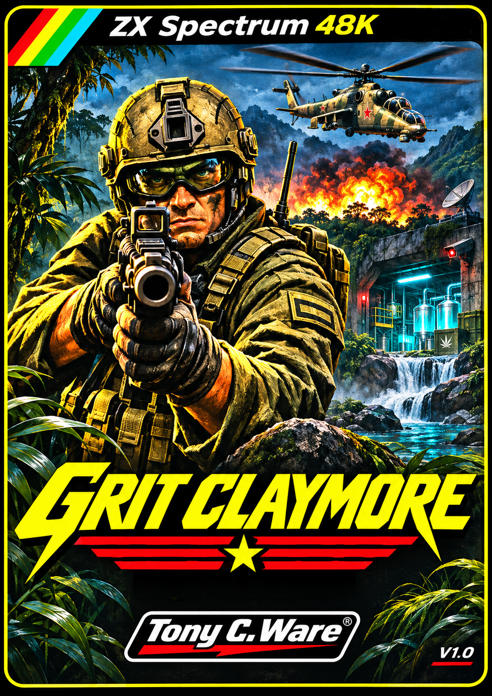

# GRIT CLAYMORE

**Edición definitiva v1.9 · ZX Spectrum 48K · 2026 · Tony C. Ware**



## La misión

En 2026, Grit Claymore, operativo de la **EFEC (European Federation Enforcer Corps)** —organización ficticia vinculada al EU INTCEN—, llega a Vietnam para desmantelar el tráfico de drogas y armamento experimental de un ejército renegado y detener a **El Comisario**.

**El mundo no se salvará por sí mismo.**

## Descargar la edición definitiva

**[GRIT CLAYMORE v1.9 — Release oficial](https://github.com/OnRail76/Grit-Claymore/releases/tag/v1.9)** · [TAP para ZX Spectrum 48K](juego/GRIT_CLAYMORE_V1.9_48K.tap)

La v1.9 es la **única edición de distribución vigente**. Las publicaciones antiguas se retiran después de preservar su material gráfico y documental en el **[archivo artístico y editorial](https://github.com/OnRail76/Grit-Claymore/releases/download/v1.9/GRIT_CLAYMORE_ARCHIVO_ARTISTICO_HISTORICO.zip)**. Los cambios técnicos anteriores siguen documentados en el [historial de desarrollo](documentacion/CHANGELOG.md) y en el historial de Git.

## Controles

| Tecla | Acción |
|---|---|
| **Q / A / O / P** | Arriba / abajo / izquierda / derecha |
| **ESPACIO** | Disparar / iniciar partida |
| **H** | Pausar / reanudar |
| **Sinclair 6 / 7 / 8 / 9 / 0** | Izquierda / derecha / abajo / arriba / disparo |
| **Kempston** | Empezar con FIRE para jugar con joystick |

## El arcade

Tres fases de disparos con movimiento en ocho direcciones, tres sectores temáticos y scroll por bloques. Grit se enfrenta a soldados, mechas y a los jefes de cada fase: **lancha patrullera, camión blindado y helicóptero Hind**.

El **tanque** se utiliza en las primeras fases, soporta cuatro impactos y dispara proyectiles perforantes. La fase final se juega a pie y permite recoger el **cañón de plasma**.

### Mejoras de la edición definitiva

- **Jefes con puntería**, disparos rectos o diagonales hacia Grit y aviso visual antes de disparar.
- **Fase de rabia** de los jefes al perder la mitad de su resistencia.
- **Soldados más reactivos**, emboscadas y apariciones variadas, especialmente al avanzar corriendo.
- **Tanque con inercia y señalización visual** de dirección y daños.
- Música del título una sola vez por visita, pausa, joystick Kempston/Sinclair y ajustes acumulados de control y mapas.

Las características completas están descritas en [RELEASE_NOTES_V1.9.md](RELEASE_NOTES_V1.9.md).

## Manual, atlas y carátulas

- [**Manual de instrucciones definitivo**](documentacion/GRIT_CLAYMORE_MANUAL_V1_9_OFICIAL.pdf), con la carátula oficial en la primera página.
- [**Atlas visual de la edición definitiva**](documentacion/GRIT_CLAYMORE_ATLAS_VISUAL_V1_9.pdf).
- [**Carátula oficial expresionista**](caratula/GRIT_CLAYMORE_CARATULA_OFICIAL.png).
- [**Tres carátulas alternativas**](caratula/alternativas/README.md), incluida la antigua portada militar oficial.
- [**Archivo artístico y editorial histórico**](https://github.com/OnRail76/Grit-Claymore/releases/download/v1.9/GRIT_CLAYMORE_ARCHIVO_ARTISTICO_HISTORICO.zip), que conserva los PDF e ilustraciones originales de las primeras publicaciones.
- [**Recursos originales y capturas del motor**](recursos/juego/).

Las imágenes extraídas de RAM proceden de pruebas con un intérprete Z80 parcial; no se presentan como capturas certificadas de Fuse o hardware real. Los PDF de las primeras ediciones se archivan como documentos históricos, no se reemplazan con recreaciones.

## Compilación e integridad

```bash
python3 -m pip install -r requirements.txt
python3 build_all.py
```

El motor reconstruye `build/GRIT_CLAYMORE_V1.9_48K.tap` y ejecuta pruebas automatizadas. La verificación de GitHub Actions coteja el TAP byte a byte con el aprobado.

**SHA-256:** `1ddb25648cd64e9fb0b36c7af87c6def9e7620365aa1256920c27c2f6e823127`

Las pruebas son una aproximación mediante intérprete Z80 parcial; no certifican el comportamiento en hardware físico.

## Autoría, licencias y derechos

**Idea, dirección creativa y decisiones finales: Tony C. Ware, © 2026.** Código y herramientas bajo [licencia MIT](LICENSE) ([versión castellana](LICENSE_ES.md)). Carátulas, sprites, logotipos e ilustraciones con derechos reservados según [LICENCIA_GRAFICOS.md](LICENCIA_GRAFICOS.md) y [DERECHOS.md](DERECHOS.md).
