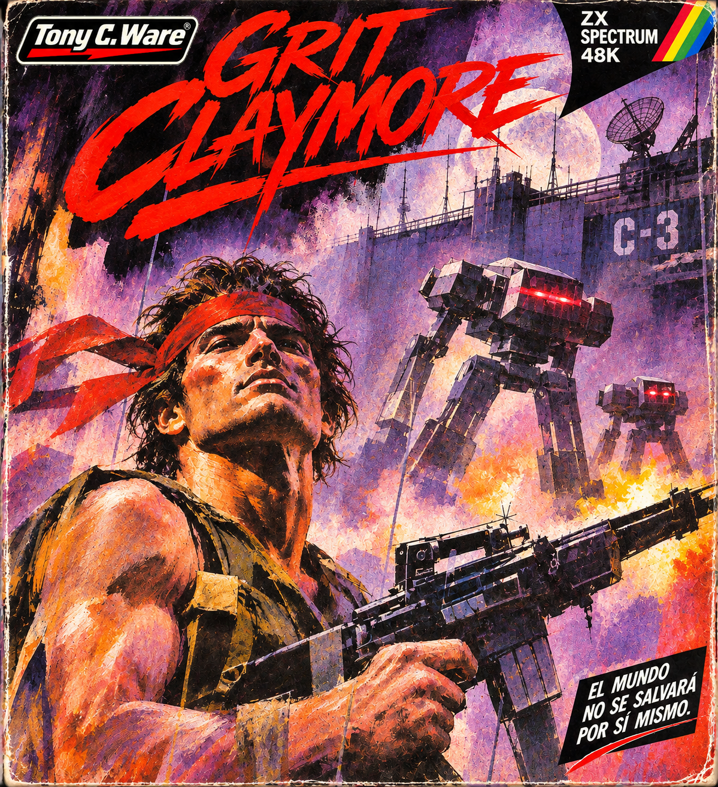

# GRIT CLAYMORE — Carátulas alternativas

**ZX Spectrum 48K · © 2026 Tony C. Ware**

Tres interpretaciones promocionales de GRIT CLAYMORE. Son ilustraciones alternativas del mismo videojuego; **no sustituyen la carátula oficial** y no representan capturas del motor del Spectrum. Todas incluyen la identidad gráfica Tony C. Ware.

| 01 · La jungla | 02 · El complejo y los mechas | 03 · Complejo expresionista |
| :---: | :---: | :---: |
|  |  |  |
| Acción militar y selva | Tecnología hostil y mechas | Pinceladas, tinta y colores dramáticos |

- [Carátula oficial que sigue vigente](../GRIT_CLAYMORE_CARATULA_OFICIAL.png)
- [Volver al proyecto](../../README.md)

La carátula experimental que llevaba un logotipo comercial ajeno **no se incluye** en esta colección.

**Derechos:** © 2026 Tony C. Ware. Todos los derechos reservados sobre las ilustraciones y logotipos. Consultar [LICENCIA_GRAFICOS.md](../../LICENCIA_GRAFICOS.md) y [DERECHOS.md](../../DERECHOS.md). La licencia MIT del código del juego no cubre estos elementos visuales.
