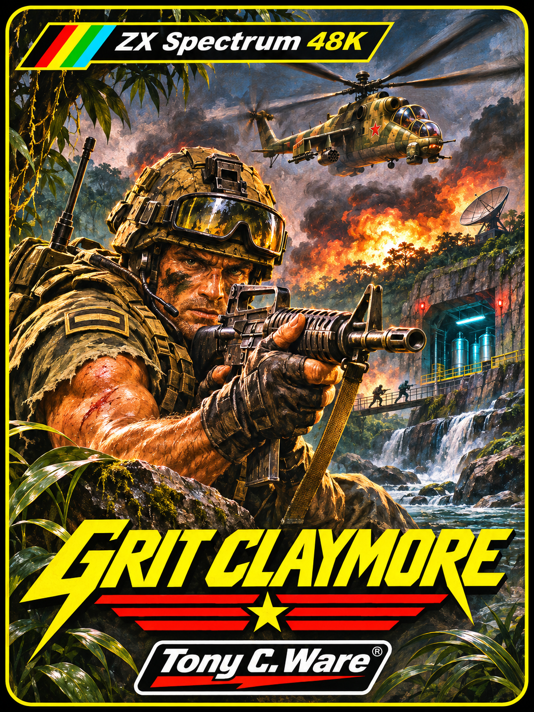
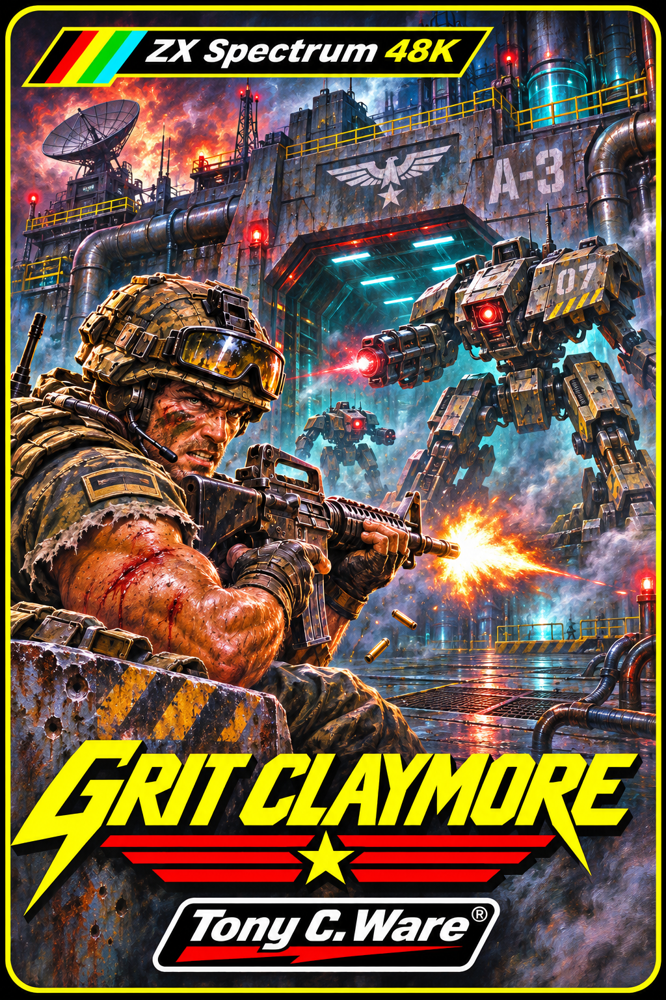

# GRIT CLAYMORE — Galería de carátulas alternativas

**ZX Spectrum 48K · © 2026 Tony C. Ware**

Desde **v1.9**, la carátula **expresionista** es la oficial. La antigua portada militar de la edición 1.0 se conserva íntegra como **alternativa clásica**. No se han redibujado ni retocado las ilustraciones.

| 01 · La jungla | 02 · Complejo y mechas | 03 · Portada clásica V1.0 |
|:---:|:---:|:---:|
|  |  |  |
| Acción militar y selva | Tecnología hostil y mechas | Anterior carátula oficial, ahora alternativa |

[**Ver carátula oficial v1.9: expresionista**](../GRIT_CLAYMORE_CARATULA_OFICIAL.png) · [Volver al proyecto](../../README.md)

Estas obras son **arte promocional**, no capturas del Spectrum. © 2026 Tony C. Ware. Recursos gráficos con derechos reservados según [licencia](../../LICENCIA_GRAFICOS.md) y [derechos](../../DERECHOS.md). La licencia MIT del código no cubre las ilustraciones.
